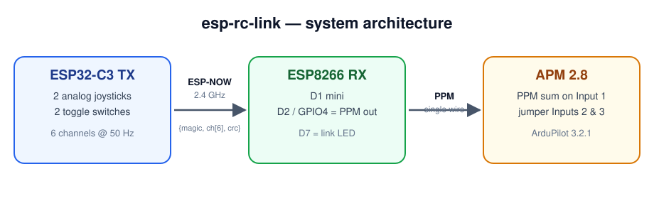
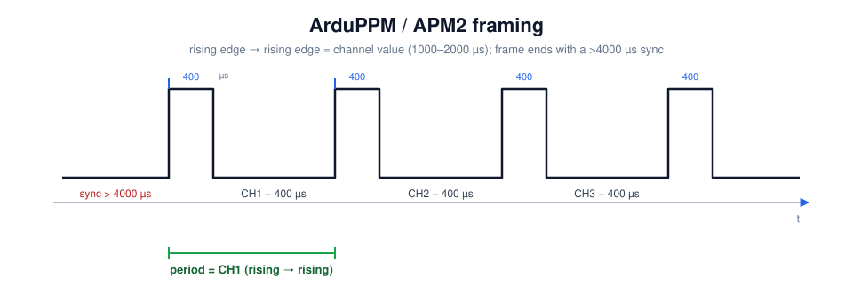
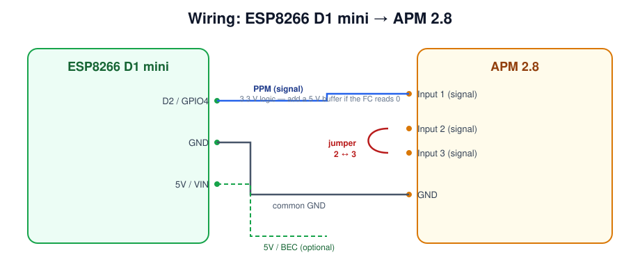

# esp-rc-link

A DIY RC link built from cheap ESP dev boards, replacing a normal RC
transmitter/receiver pair:

- **Transmitter:** ESP32‑C3 SuperMini — reads two analog joysticks + two toggle
  switches, maps them to 6 RC channels, and sends them over **ESP‑NOW**.
- **Receiver:** ESP8266 D1 mini — receives the packet and emits a **single‑wire
  PPM (CPPM) sum signal** that an old flight controller (APM 2.8 / ArduPilot)
  can decode.



## Why this is interesting

The tricky part is the PPM format. The APM2's ATmega2560 decoder does **not**
measure pulse widths — it measures the **period between rising edges** and uses
that as the channel value. The canonical **ArduPPM / 3DR PPM encoder** therefore
emits each channel as `400 µs gap + (value − 400) µs pulse`, so that
`period == channel value` (1000–2000 µs), followed by a long (>4 ms) sync period.
Getting this exactly right (polarity + structure) is what makes the APM decode
the stream instead of showing all‑zero channels. See
[`docs/PPM_FORMAT.md`](docs/PPM_FORMAT.md).



## Hardware

| Role | Board | Notes |
|------|-------|-------|
| TX   | ESP32‑C3 SuperMini | 2× analog joystick (VRx/VRy), 2× toggles |
| RX   | WeMos D1 mini (ESP8266) | PPM out on `D2 / GPIO4`, link LED `D7 / GPIO13` |

### TX pin map (ESP32‑C3)

| Function | GPIO | SuperMini label |
|----------|------|-----------------|
| J1 X     | 0    | J1.X |
| J1 Y     | 1    | J1.Y |
| J2 X     | 3    | J2.X |
| J2 Y     | 4    | J2.Y |
| SW1      | 5    | SW1 (INPUT_PULLUP) |
| SW2      | 6    | SW2 (INPUT_PULLUP) |

### RX pin map (ESP8266 D1 mini)

See [`docs/RECEIVER_PINOUT.md`](docs/RECEIVER_PINOUT.md). PPM signal → `D2 (GPIO4)`.

### Wiring to the flight controller (APM 2.x)



- `D2 (GPIO4)` → FC **Input 1** signal pin (PPM).
- `GND` → FC **GND** (common ground — required).
- `5V/VIN` → BEC 5 V (optional).
- Place a **jumper across the signal pins of RC Inputs 2 and 3** — the APM2
  requires this to accept an external PPM sum on Input 1.

> **Level tip:** the ESP outputs 3.3 V logic; the APM2 AVR input expects ~5 V.
> It usually works at 3.3 V, but if the FC still shows zero channels after the
> format is correct, add a 5 V buffer / level shifter on the PPM line.

## Firmware

```
firmware/
├── c3_tx_rc/               ESP32-C3 transmitter (ESP-NOW sender)
├── esp8266_rx_ppm/         ESP8266 receiver (ESP-NOW -> PPM)
├── esp8266_ppm_loopback/   self-test: generate PPM on D2, read back on D5
├── c3_axis_probe/          TX diagnostic: raw ADC + mV per axis
└── ppm_reader_esp32/       ESP32 PPM decoder (standalone verifier)
```

### Toolchain

```sh
# cores
arduino-cli core install esp32:esp32        # tested with 2.0.17
arduino-cli core install esp8266:esp8266    # tested with 3.1.1
```

### Build & flash the transmitter

```sh
arduino-cli compile --fqbn "esp32:esp32:esp32c3:CDCOnBoot=cdc" firmware/c3_tx_rc
arduino-cli upload  -p /dev/cu.usbmodem1101 \
  --fqbn "esp32:esp32:esp32c3:CDCOnBoot=cdc" firmware/c3_tx_rc
```

> If upload fails with *"No serial data received"* (the running sketch floods
> USB‑CDC), put the C3 in download mode: hold **BOOT**, tap **RESET**, release
> **BOOT**. Tap RESET once after flashing.

### Build & flash the receiver

```sh
arduino-cli compile --fqbn "esp8266:esp8266:nodemcuv2" firmware/esp8266_rx_ppm
arduino-cli upload  -p /dev/cu.usbserial-XXXX \
  --fqbn "esp8266:esp8266:nodemcuv2" firmware/esp8266_rx_ppm
```

### Verify the receiver's PPM (loopback)

Jumper **D2 → D5**, flash `firmware/esp8266_ppm_loopback`, and open the serial
monitor at 115200. You should see the measured periods equal the test values:

```
frame=30 period=20042us ch=6 : 1006 1206 1406 1606 1806 2006
```

That is exactly what the APM2 reads as channel values (1000…2000 + a few µs).

## Configurator (Web Serial)

`configurator/index.html` is a browser UI (Chrome/Edge) that talks to the TX
over **Web Serial**: live channel bars, stick↔channel mapping labels, and
calibration. Serve it locally:

```sh
python3 -m http.server 8123 --directory configurator
# open http://localhost:8123/
```

## Troubleshooting

| Symptom | Cause / fix |
|---------|-------------|
| FC shows **all channels 0** | PPM format/polarity must match ArduPPM (fixed here); check Input 2↔3 jumper, common GND, and 3.3 V→5 V level |
| RX `link=LOST` | TX unplugged / out of range / wrong ESP‑NOW channel |
| `good=0` + `txcb FAIL` | ESP‑NOW version mismatch (v1.0 vs v2.0) — pin esp32 core 2.0.17 |
| RX crash‑loops | ESP8266 core 3.1.2 Wi‑Fi regression — use 3.1.1 |
| Sluggish stick response | 50 Hz PPM + `kAvg=8` ADC averaging in the TX; lower `kAvg` |

## License

MIT — see [`LICENSE`](LICENSE).
